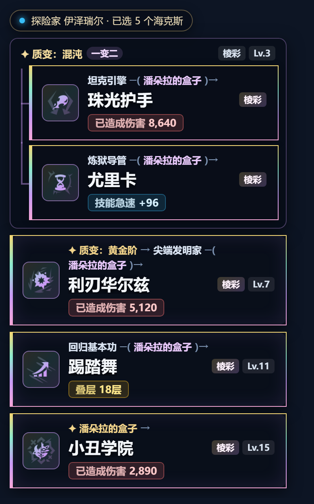
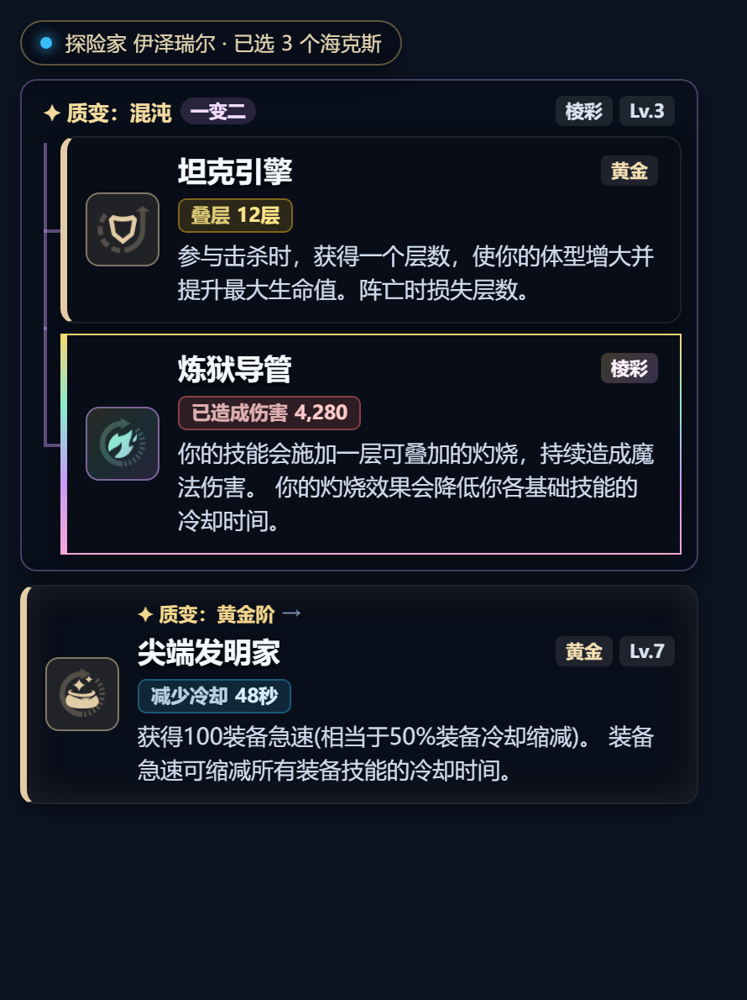
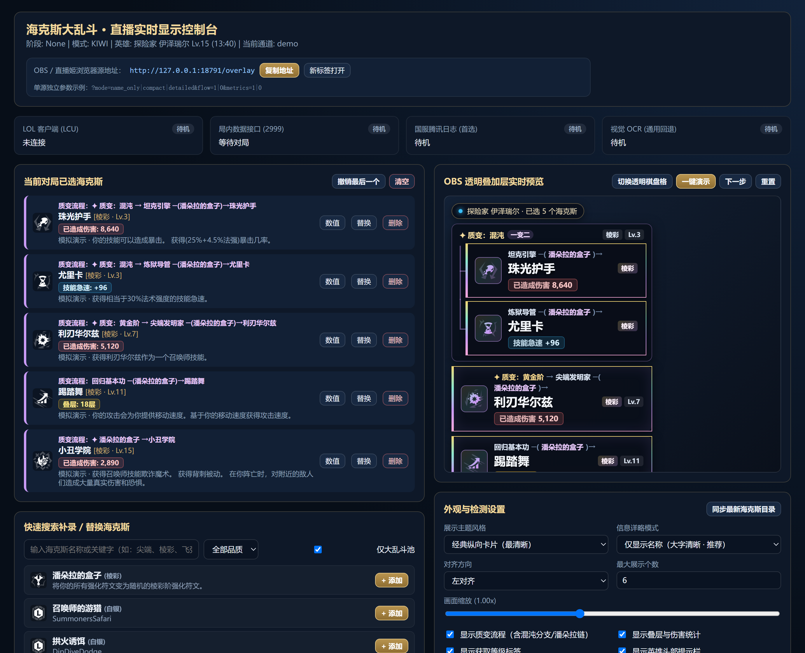

# 英雄联盟海克斯大乱斗（ARAM: Mayhem）直播海克斯实时显示插件

面向《英雄联盟》**海克斯大乱斗（ARAM: Mayhem）**主播的轻量级直播叠加层插件：在对局中实时识别主播选取的强化符文，并通过透明网页源实时展示在 **OBS Studio / B 站直播姬 / 虎牙开播 / 抖音直播伴侣** 的直播画面上，让半路进入直播间的观众随时看清已选海克斯、质变路径与数值统计。

## 效果展示

### OBS 透明叠加层（大字清晰模式 vs 详细功能模式）

| 仅显示名称（大字清晰 · 推荐）+ 混沌/潘朵拉连锁流程 | 详细功能描述模式 + 混沌一变二分支 |
| :---: | :---: |
|  |  |

### 主播控制台（实时预览 / 质变溯源 / 数值在线编辑 / 演示调试）



## 核心特性

- **双通道融合识别，合规无侵入**：不读取游戏内存、不注入 DLL、不修改游戏文件、不模拟键鼠操作。
  - **国服首选通道（腾讯 `icreate-sdk` 只读加密日志）**：在 LCU 检测到国服（`TENCENT` / `CN` / `CHINA`）时，仅在内存中派生解密密钥增量读取 `icreateLogs/main.log` 的 `693`（候选）、`694`（本地选取下标）、`696`（全员已选安全校准）事件，毫秒级精准同步，兼容海斗 4.0 四选一、质变类符文与 K/DA 额外海克斯。
  - **全服通用回退通道（Windows 原生 OCR + 视觉状态机）**：在非国服或缺少腾讯组件日志时自动接管，基于 Win32 GDI 屏幕像素采样（`SRCCOPY`）、3 卡/4 卡边框几何检测、Windows 内置 `Windows.Media.Ocr` 标题识别与被动鼠标点击/卡片高光闪光判断选取结果，支持“收起面板后重新展开”自动撤回误记。
- **开箱即用，无需 OBS WebSocket**：独立提供 `http://127.0.0.1:18777/overlay` 透明浏览器源与 `http://127.0.0.1:18777/control` 主播控制台。
- **4 套直播展示主题**：`vertical`（经典纵向卡片）、`showcase`（焦点弹窗 + 纵向列表）、`tray`（横向 HUD 托盘）、`strip`（极简单行紧凑条），还原游戏内白银 / 黄金 / 棱彩全息渐变视觉效果。
- **3 种信息详略模式 + 大字排版**：支持 `name_only`（默认 `20px` 加粗名称 + 徽标，直播最清晰）、`compact`（名称 + 单行简介）、`detailed`（名称 + 完整说明，避免长文挤小字），支持任意 OBS 场景通过 URL 参数单独覆盖。
- **质变流程与树形分支追踪**：自动记录并展示单次质变、一变二树形分支与后续连锁重随，支持开关控制。
- **叠层与伤害/治疗/护盾/金币统计**：支持在控制台点击「数值」按钮随时录入/更新并生成高对比徽标，同时提供实验性只读「悬停抓拍（Windows OCR）」能力。
- **内置离线目录与同局断点恢复**：内置 574 个强化符文中文目录（含 346 个活跃池标记与中文说明），直播途中断开重启自动恢复本局已选、质变链与数值记录。
- **零游戏调试模式**：控制台内置 6 步进阶「一键演示 / 单步推进」（含混沌一变二、黄金质变、潘朵拉连锁重随与数值徽标）及中文快速搜索补录、替换、撤销功能。

## 质变流程与数值统计说明

### 1. 质变流程追踪（国服日志通道 & 演示模式）

- **单次质变（1 变 1）**：选取`质变：黄金阶`、`质变：棱彩阶`、`质变：白银阶`或`不稳定突变`后，在生效卡片上方显示来源路径，如 `✦ 质变：黄金阶 → 尖端发明家`。
- **质变：混沌（1 变 2）**：触发后自动将两个裂变结果聚合至同一个树形分组框内（`✦ 质变：混沌 一变二` + `├─` / `└─` 连线）。
- **潘朵拉的盒子连锁重随**：后续拿取`潘朵拉的盒子`重随全部已选符文时，会按槽位串联前置记录并保留原始分组，例如：
  - `✦ 质变：混沌` 下的 `坦克引擎 ─(潘朵拉的盒子)→ 珠光护手`、`炼狱导管 ─(潘朵拉的盒子)→ 尤里卡`
  - `✦ 质变：黄金阶 → 尖端发明家 ─(潘朵拉的盒子)→ 利刃华尔兹`
  - 以及潘朵拉自身多出槽位对应的 `✦ 潘朵拉的盒子 → 小丑学院`
- **尊我为王（`KingMe`）**：中期乘敌方传送门触发奖励棱彩强化时，自动关联 `✦ 尊我为王 →` 来源标签。

### 2. 叠层与伤害统计

> 说明：拳头本地 `Live Client Data (2999)` 接口与腾讯 `main.log`（`693/694/696`）均**不直接实时下发**单个海克斯的累计叠层或伤害统计。

因此本插件提供两种合规记录方式：
- **控制台在线录入（「数值」按钮）**：支持为任意已选海克斯添加/修改/清空多条 `叠层`、`已造成伤害`、`已治疗`、`已提供护盾`、`已获金币` 与 `减少冷却/触发次数` 徽标，保存后秒级推送到 OBS 叠加层。
- **实验性只读「悬停抓拍（Windows OCR）」**：在设置中勾选后，当你在对局内将鼠标悬停在底部栏海克斯图标（或按住 `Tab` 悬停记分板图标）停顿约 `0.35s` 时，纯视觉 OCR 会识别浮窗中的累计数值并自动刷新对应海克斯徽标。

## OBS 多场景 URL 参数

可直接将同一个服务挂载到多个 OBS 场景，并通过查询参数为每个场景指定独立风格与显示项：

| 参数 | 可选值 | 说明 |
| --- | --- | --- |
| `mode` | `name_only` / `compact` / `detailed` | 覆盖详略模式（名称大字 / 单行简介 / 完整描述） |
| `theme` | `vertical` / `showcase` / `tray` / `strip` | 覆盖展示主题布局 |
| `flow` | `1` / `0` | 是否显示质变流程与树形分支 |
| `metrics` | `1` / `0` | 是否显示叠层与伤害统计徽标 |
| `level` | `1` / `0` | 是否显示获取等级标签（`Lv.3` 等） |
| `header` | `1` / `0` | 是否显示英雄头部状态栏 |
| `align` | `left` / `center` / `right` | 卡片对齐方向 |
| `scale` | `0.5` ~ `2.0` | 缩放倍率（如 `1.15`） |
| `max` | `1` ~ `12` | 最大显示条数 |

示例：
- 仅大字名称 + 质变 + 数值：`http://127.0.0.1:18777/overlay?mode=name_only&flow=1&metrics=1`
- 详细描述完整展示版：`http://127.0.0.1:18777/overlay?theme=vertical&mode=detailed&flow=1&metrics=1`
- 底部超紧凑极简单行条：`http://127.0.0.1:18777/overlay?theme=strip&mode=name_only&flow=0`

## 快速开始

1. 安装依赖（Python 3.10+，Windows 10/11）：
   ```powershell
   pip install -r requirements.txt
   ```
2. 双击 `start.bat` 或运行：
   ```powershell
   python -m hextech_overlay --open-browser
   ```
3. 在 **OBS Studio / 直播姬** 中添加 **浏览器（Browser）** 来源：
   - URL：`http://127.0.0.1:18777/overlay`（或带上方任意 URL 参数）
   - 推荐尺寸：纵向模式 `420 × 640`（横向 `tray`/`strip` 主题可用 `980 × 180`）
   - 背景默认透明，无需额外设置自定义 CSS。
4. 游戏视频设置建议为 **无边框全屏（Borderless）**，以便视觉回退或悬停抓拍时稳定采集窗口画面。

## 目录结构

- `hextech_overlay/models.py`：Pydantic 状态、质变链路（`TransformStep`）、数值统计（`AugmentMetric`）与配置模型
- `hextech_overlay/config.py`：配置文件（兼容旧配置迁移）与同局会话断点存储
- `hextech_overlay/catalog.py`：离线目录加载、LCU/CDragon 同步、OCR 模糊匹配与图标缓存
- `hextech_overlay/lcu.py` & `hextech_overlay/live_api.py`：LCU 与 `127.0.0.1:2999` 只读接口轮询
- `hextech_overlay/tencent_log.py`：国服 `icreate-sdk` 加密日志解码、增量 tail 与 `693/694/696` 状态机
- `hextech_overlay/vision_detector.py`：3/4 卡几何布局检测、GDI 采集、Windows OCR 工作器、点击/闪光状态机与悬停浮窗数值解析
- `hextech_overlay/engine.py`：双通道编排引擎、质变链路拼接、手动编辑与 6 步演示模式
- `hextech_overlay/server.py` & `hextech_overlay/__main__.py`：FastAPI HTTP/WebSocket 服务与 CLI 入口
- `hextech_overlay/static/overlay.html` & `control.html`：OBS 透明叠加层与主播控制台前端
- `scripts/sync_bundled_catalog.py`：从 CommunityDragon 更新离线强化目录
- `docs/images/`：README 效果展示截图
- `tests/`：单元测试与 API/WebSocket 集成测试

## 开发与测试

```powershell
# 运行全部单元测试与集成测试
python -m unittest discover -s tests -v

# 更新内置中文强化目录
python scripts/sync_bundled_catalog.py
```
